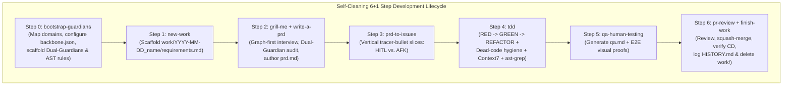

# Chassi

A project-agnostic AI software engineering chassis and development backbone that combines **Self-Cleaning Ephemeral Specs**, **Dialectical Dual-Guardian Ontology Governance**, **Two-Tier Structural Code Graphs (`Graphify` + `codebase-memory-mcp`)**, and **Deterministic AST & Anti-Doc-Rot Guardrails (`domain-guard.mjs` + `ast-grep`)**.

---

## Core Architecture & Philosophy



### The 5 Pillars

1. **Self-Cleaning Ephemeral Specs (Zero Context Rot)**
   - Active specifications (`requirements.md`, `prd.md`, `issues/NNN-*.md`, `qa.md`) live in `work/<YYYY-MM-DD>_<name>/` only while the work is in flight.
   - Upon PR squash-merge and CD verification (`finish-work`), a permanent one-line record with the PR link is appended to `work/HISTORY.md`, and `work/<YYYY-MM-DD>_<name>/` is deleted from the default branch so future AI sessions never suffer from stale specification rot.
2. **Epistemic Confidence Tagging (`[EXTRACTED]` vs. `[INFERRED]` vs. `[AMBIGUOUS]`)**
   - **`[EXTRACTED]` (`confidence: 1.0`)**: Directly verified in AST, database schema, or source code with exact file/line links. Agents must **never** ask the human about facts already `[EXTRACTED]` in the codebase.
   - **`[INFERRED]` (`confidence: 0.5–0.9`)**: Reasoned from multi-hop call graphs, mocks, or indirect wiring.
   - **`[AMBIGUOUS]` (`confidence: 0.1–0.4`)**: Missing specification or conflicting definitions requiring explicit human decision.
3. **Dialectical Dual-Guardians (`ontology-*-guardian` $\times$ `business-*-guardian`)**
   - Every core bounded context is governed by a paired **Technical/Ontology Guardian** (who fights God tables, scalar overwrites of time-series metrics, platform-coupled naming, and cross-tenant leaks) and **Business/Domain Guardian** (who enforces domain laws, state-machine invariants, regulatory compliance, and safety).
4. **Two-Tier Structural Code Intelligence (`Graphify` + `codebase-memory-mcp`)**
   - **Macro-Topology (`Graphify`)**: Leiden community clustering, cohesion scores, God-Node degree centrality, surprising cross-community bridges, and circular import detection—updated at zero token cost in `.husky/post-commit`.
   - **Micro-Tracing (`codebase-memory-mcp`)**: LSP-backed symbol navigation, call-path tracing, dead-code/unused-export detection, and cross-service HTTP route resolution.
5. **Deterministic AST & Anti-Doc-Rot Guardrails (`domain-guard.mjs` + `ast-grep`)**
   - Driven declaratively by `.agents/backbone.json`:
     - Path-resolved workspace/app boundary isolation
     - Cross-layer import leak blocking (e.g., preventing UI from importing DB layers)
     - Zero-drift schema-to-migration checks + destructive SQL migration blocking (`DROP TABLE`, `DROP COLUMN`, `TRUNCATE` require `-- @guardian-approved: <reason>`)
     - Unit-tested `ast-grep` YAML rules (`.ast-grep/rules/` & `.ast-grep/tests/`)
     - Deterministic zero-cycle enforcement on `graphify-out/GRAPH_REPORT.md`
     - Anti-Doc-Rot verification ensuring every `file://` link in `AGENTS.md` and `.agents/` resolves on disk

---

## Quick Start

### Option A: Install into an Existing or New Repository via CLI

Run the installer pointing to any target repository:

```bash
node /path/to/chassi/bin/init.mjs /path/to/target-repo
```

Optional flags:
- `--name <project-name>`: Override the project name written into `.agents/backbone.json` (defaults to target folder name).
- `--branch <default-branch>`: Override the default git branch (`main` or `master`, auto-detected when git is initialized).
- `--force`: Overwrite existing backbone files in the target repository.

### Option B: Copy `template/` Directly for a Brand-New Project

```bash
cp -R /path/to/chassi/template/. /path/to/new-project/
```

---

## Onboarding a Project After Installation (Step 0)

Once installed in your target repository:

1. Build the initial structural graphs:
   ```bash
   yarn graph:build
   yarn cbm:index
   ```
2. Ask your AI agent to run the **`bootstrap-guardians`** skill:
   > *"Run `bootstrap-guardians` to inspect our project structure, configure `.agents/backbone.json`, scaffold our Dual-Guardian pairs, and add initial `.ast-grep/rules/`."*
3. Verify the guardrails:
   ```bash
   yarn ast:test
   yarn guard:domain --full
   ```
