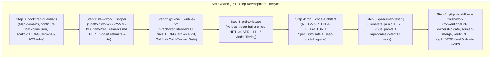

# Chassi

A project-agnostic AI software engineering chassis and development backbone that combines **System-1 Decision Gates & Model/Effort Routing**, **Self-Cleaning Ephemeral Specs**, **Dialectical Dual-Guardian Ontology Governance**, **Two-Tier Structural Code Graphs (`Graphify` + `codebase-memory-mcp`)**, and **Deterministic AST & Anti-Doc-Rot Guardrails (`domain-guard.mjs` + `ast-grep`)**.

---

## Core Architecture & Philosophy



### The 7 Pillars

1. **System-1 Decision Gate, Spec Drift Gate & 6-Tier Router (`scripts/decide.mjs`)**
   - **6-Level Model & Effort Matrix (`L1`–`L6`)**: Dynamically routes prompts and slices to the optimal model and reasoning effort across Antigravity CLI/UI, AGY Subagent Tool (`flash_lite`, `flash`, `pro`), Claude Code CLI, and Cursor.
   - **Spec Drift Gate (EGM Pattern)**: Evaluates git diffs against acceptance criteria (`- [ ] ...`) to prevent unstated scope creep, unexpected database mutations, or secret leaks before code review.
   - **Fast Non-Generative Primitives**: `--noul` (Boolean), `--choice` (constrained enum), and `--score` (ordinal evaluation) with calibrated offline heuristic fallback (<15ms).
2. **Multi-IDE Native Auto-Discovery & Bindings**
   - **Google Antigravity CLI / AGY**: Automatic discovery via `.antigravity/` and `.agent/` bindings.
   - **Cursor**: Rule configurations in `.cursor/rules/` (`code-architect.md`, `pr-reviewer.md`, `guardians.md`).
   - **Claude Code**: Tailored operating instructions in `CLAUDE.md`.
   - **Universal Agent Root**: Standardized `AGENTS.md` serving as the single engineering entry point.
3. **Self-Cleaning Ephemeral Specs (Zero Context Rot)**
   - Active specifications (`requirements.md`, `prd.md`, `issues/NNN-*.md`, `qa.md`) live in `work/<YYYY-MM-DD>_<name>/` only while the work is in flight.
   - Upon PR squash-merge and CD verification (`finish-work`), a permanent one-line record with the PR link is appended to `work/HISTORY.md`, and `work/<YYYY-MM-DD>_<name>/` is deleted from the default branch so future AI sessions never suffer from stale specification rot.
   - **Repository Ownership Gate**: Internal repos execute full automated squash-merge and work folder cleanup; client-owned repos stop at PR review and visual handoff.
4. **The Goldfish Cold-Review Gate, UI Design Dials & 6 Presets**
   - **Goldfish Cold-Review Gate**: Dispatches an isolated, zero-context subagent to attack `prd.md` cold before slicing, finding blind spots that were invisible to the planning conversation.
   - **UI Design Dials (`templates/design.md`)**: Configures `DESIGN_VARIANCE`, `MOTION_INTENSITY`, and `VISUAL_DENSITY` on a 1–10 scale.
   - **6 Ready-to-Use Design Presets**:
     - `linear-dark.md` — Cybernetic, keyboard-driven productivity & developer tools
     - `b2b-clean.md` — Enterprise SaaS, dashboards, data tables
     - `editorial-bold.md` — Publishing, media, high-contrast serif typography, bold editorial
     - `clinical-clean.md` — Healthcare, data platforms, medical, sterile, high-legibility
     - `warm-approachable.md` — Warm, approachable, rounded, consumer mobile, community & wellness
     - `studio-obsidian.md` — Dark studio craft, warm obsidian, brushed brass accents
5. **Dialectical Dual-Guardians (`ontology-*-guardian` $\times$ `business-*-guardian`)**
   - Every core bounded context is governed by a paired **Technical/Ontology Guardian** (who fights God tables, scalar overwrites of time-series metrics, platform-coupled naming, and cross-tenant leaks) and **Business/Domain Guardian** (who enforces domain laws, state-machine invariants, regulatory compliance, and safety).
   - **Scoper Agent & PERT Risk Calculator**: Translates raw client briefs into 3-point estimates ($E = \frac{O + 4M + P}{6}$), risk buffers (10% / 20% / 35%), and quote tables via `estimate-calc.py`.
6. **Two-Tier Structural Code Intelligence (`Graphify` + `codebase-memory-mcp`)**
   - **Macro-Topology (`Graphify`)**: Leiden community clustering, cohesion scores, God-Node degree centrality, surprising cross-community bridges, and circular import detection—updated at zero token cost in `.husky/post-commit`.
   - **Micro-Tracing (`codebase-memory-mcp`)**: LSP-backed symbol navigation, call-path tracing, dead-code/unused-export detection, and cross-service HTTP route resolution.
7. **Deterministic AST & Anti-Doc-Rot Guardrails (`domain-guard.mjs` + `ast-grep`)**
   - Driven declaratively by `.agents/backbone.json`:
     - Path-resolved workspace/app boundary isolation
     - Cross-layer import leak blocking (e.g., preventing UI from importing DB layers)
     - Zero-drift schema-to-migration checks + destructive SQL migration blocking (`DROP TABLE`, `DROP COLUMN`, `TRUNCATE` require `-- @guardian-approved: <reason>`)
     - Unit-tested `ast-grep` YAML rules (`no-raw-sql-drop`, `no-hard-delete-immutable-records`, `no-scalar-weight-overwrite`)
     - Zero plaintext secrets guard with multi-token patterns (`scan-secrets.mjs`)
     - Deterministic zero-cycle enforcement on `graphify-out/GRAPH_REPORT.md`
     - Anti-Doc-Rot verification ensuring every `file://` link in `AGENTS.md` and `.agents/` resolves on disk

---

## Quick Start

### Option A: Install into an Existing or New Repository via CLI

Run the installer pointing to any target repository:

```bash
node /path/to/chassi/bin/init.mjs /path/to/target-repo
```

Optional flags:
- `--name <project-name>`: Override the project name written into `.agents/backbone.json` and `templates/design.md` (defaults to target folder name).
- `--branch <default-branch>`: Override the default git branch (`main` or `master`, auto-detected when git is initialized).
- `--force`: Overwrite existing backbone files in the target repository.

### Option B: Copy `template/` Directly for a Brand-New Project

```bash
cp -R /path/to/chassi/template/. /path/to/new-project/
```

---

## Developer Workflow & Makefile Commands

A unified `Makefile` is included out-of-the-box:

```bash
make help                                   # Display all available commands
make test                                   # Run guard, AST tests, and System-1 smoke check
make guard                                  # Run domain, ontology & architecture guard
make ast-test                               # Run ast-grep test suite
make decide route="Build webhook retries"   # Route task across L1-L6 Model & Effort Matrix
make decide drift=issues/001-slice.md       # Check for Spec Drift against issue criteria
make secrets full=1                         # Scan entire codebase for plaintext credentials
make estimate risk=medium rate=150          # Generate risk-weighted PERT quote
make work-new name=billing_portal           # Scaffold work folder & feature branch
make graph-build                            # Build macro Graphify AST topology graph
make graph-update                           # Incrementally update Graphify graph
```

---

## Onboarding a Project After Installation (Step 0)

Once installed in your target repository:

1. Build the initial structural graphs:
   ```bash
   make graph-build
   yarn cbm:index
   ```
2. Ask your AI agent to run the **`bootstrap-guardians`** skill:
   > *"Run `bootstrap-guardians` to inspect our project structure, configure `.agents/backbone.json`, scaffold our Dual-Guardian pairs, and add initial `.ast-grep/rules/`."*
3. Verify the guardrails:
   ```bash
   make test
   ```
