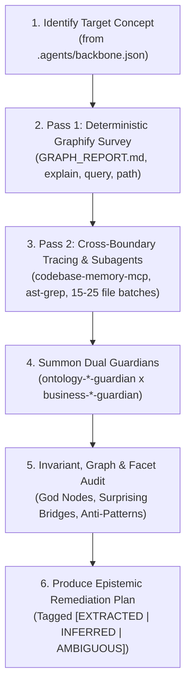

# Domain Ontology Audit Workflow

This skill scans the codebase for a specific domain concept or entity, surveys its structural graph and data structures across all layers (DB, API, frontend), and consults the specialized **Dual-Guardian Pair** (`ontology-*-guardian` $\times$ `business-*-guardian`) registered in [`.agents/backbone.json`](file:///.agents/backbone.json) to detect schema anti-patterns, leaky domain abstractions, and missing facets.

---

## When to Run

- **Pre-Implementation & Refactoring**: Before creating new features that alter entity tables or cross application boundaries.
- **Entity Health Checks**: To discover domain drift between different services or frontend applications.
- **PR Schema Review**: During code reviews when database migrations or core domain interfaces are touched.

---

## Audit Workflow Steps

### Step 1: Identify Target Concept
Determine the domain concept to audit from [`.agents/backbone.json`](file:///.agents/backbone.json) and identify which workspaces/apps are primary consumers.

### Step 2: Pass 1 — Deterministic Graphify Knowledge Graph Survey (Zero-Token AST Pass)
Before grepping or reading raw files across the codebase, query the local **Graphify Knowledge Graph** (`graphify-out/`):
1. **Check Graph Freshness**:
   - Inspect `graphify-out/GRAPH_REPORT.md`. If missing or stale, run `yarn graph:update` (or `yarn graph:build`).
2. **Run Structural Graph Queries**:
   - `yarn graph:explain <node>` to list all incoming/outgoing AST edges.
   - `yarn graph:query "<concept>"` to traverse BFS/DFS neighborhoods around the domain concept.
   - `yarn graph:path "<NodeA>" "<NodeB>"` to find shortest dependency paths between frontend components and backend handlers/tables.
3. **Evaluate Graph Topology Signals**:
   - **God Nodes (Degree Centrality)**: Check if the target table or service has become an over-connected hub absorbing unrelated concerns.
   - **Surprising Connections (Betweenness Centrality)**: Identify cross-community bridges where a module in one domain directly couples to an internal type or table in another domain.
   - **Leiden Community Alignment**: Compare Graphify's detected communities against the intended Ontology Guardian boundaries. Low cohesion or fragmented communities signal domain leakage.

### Step 3: Pass 2 — Cross-Boundary Tracing (`codebase-memory-mcp` & `ast-grep`) + Subagent Chunking
Because untyped AST graphs cannot cross HTTP string boundaries (`fetch("/api/...")`), use **`codebase-memory-mcp`** and **`ast-grep` (`sg`)** in Pass 2:
1. **Cross-Boundary Symbol & Route Tracing (`codebase-memory-mcp` + `ast-grep`)**:
   - Trace the full vertical chain: Database schema (`schemas.schemaFile` in `.agents/backbone.json`) $\rightarrow$ DTO / Validator $\rightarrow$ Controller / Handler $\rightarrow$ HTTP route / Mock handler $\rightarrow$ Client API call $\rightarrow$ UI components.
   - Run `yarn ast:scan` (or `sg run -p '<pattern>'`) to check structural AST patterns in `<100ms` without regex false positives.
2. **Parallel Subagent Chunking**:
   - When auditing rich semantic logic across more than 20 files or multiple apps simultaneously, split the file list into chunks of 15–25 files and invoke `research` subagents in parallel to extract entity shapes and business assumptions without saturating context.

### Step 4: Summon the Relevant Dual Guardians
Consult the paired agent specifications registered for that domain in [`.agents/backbone.json`](file:///.agents/backbone.json) (or use the baseline templates [`ontology-template-guardian.md`](file:///.agents/agents/ontology-template-guardian.md) $\times$ [`business-template-guardian.md`](file:///.agents/agents/business-template-guardian.md)).

### Step 5: Audit Invariants & Anti-Patterns
Evaluate the findings against the Dual Guardians' core invariants:
1. **Anti-God Table & God-Node Check**: Is the base table absorbing non-core attributes, UI metadata, or showing excessive degree centrality in Graphify?
2. **Time-Series vs. Scalar Check**: Are fluctuating metrics collapsed into single scalar overwrite columns?
3. **Concept vs. Platform Check**: Are tables named after client apps instead of timeless domain concepts?
4. **Data Isolation & Parity Check**: Is domain state trapped in frontend `localStorage` or duplicated across client apps?
5. **Provenance, Regulatory & Authority Check**: Is verification authority tracked separately from self-reported data, and do workflows obey regulatory/financial immutability rules?

### Step 6: Epistemic Confidence Tagging & Remediation Report
Every finding, dependency claim, and architectural gap in the audit report **MUST** carry an explicit **Epistemic Confidence Tag**:
- **`[EXTRACTED]` (`confidence: 1.0`)**: Directly verified in AST, SQL schema, or source code with exact file + line link.
- **`[INFERRED]` (`confidence: 0.5–0.9`)**: Reasoned from multi-hop call graphs, mock handlers, or UI prop structures where backend wiring is indirect.
- **`[AMBIGUOUS]` (`confidence: 0.1–0.4`)**: Conflicting definitions across apps, missing backend persistence, or unverified domain rules requiring human decision.

Produce a structured markdown audit report containing:
- **Executive Summary & Compliance Status** (`PASS`, `WARN`, `FAIL`) + Extraction Breakdown (`% EXTRACTED`, `% INFERRED`, `% AMBIGUOUS`).
- **Graph Topology Summary**: Degree centrality of core nodes, surprising cross-domain connections, and community cohesion.
- **Detected Anti-Patterns & Code Locations** (each tagged with `[EXTRACTED]`, `[INFERRED]`, or `[AMBIGUOUS]` and clickable `file://` links).
- **Target Conceptual Facet Model** (Mermaid diagram or schema table).
- **Prioritized Action Plan** (`P0 / Critical` through `P3 / Low`).
